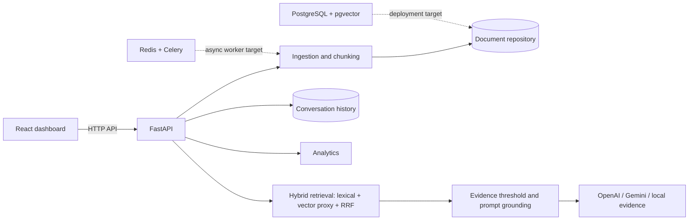

# EnterpriseIQ architecture

The current local implementation keeps data in process memory so it starts without infrastructure. The Compose file provisions PostgreSQL with pgvector and Redis, but persistence and background worker adapters remain explicit extension points. Retrieved document text is untrusted input: the model prompt separates it from instructions and the backend owns authorization and filtering decisions.
